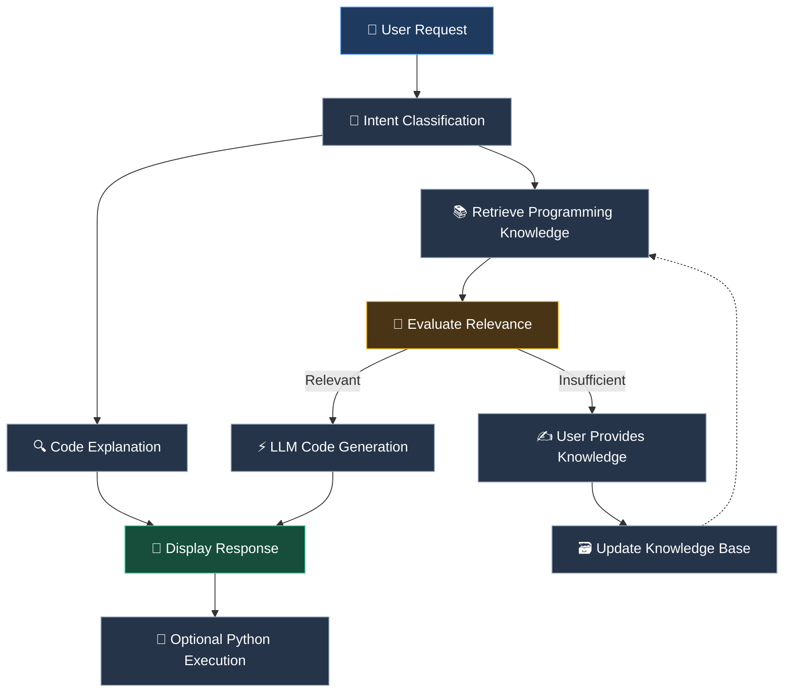

# 💻 Intelligent AI Coding Assistant

### Understand Code. Generate Solutions. Expand Knowledge.

An AI-powered coding assistant that combines Large Language Models, semantic knowledge retrieval, and relevance evaluation to deliver a smarter programming experience.

 

---

## ✨ Overview

The **Intelligent AI Coding Assistant** is an interactive application designed to help developers understand programming code and generate solutions using AI.

Instead of relying only on an LLM's existing knowledge, the system retrieves relevant programming information from a ChromaDB knowledge base and evaluates its relevance before generating code.

When the available knowledge is insufficient, users can contribute additional programming references, helping expand the knowledge available for future requests.

## 🚀 Key Features

| Feature                      | Description                                                                                |
| ---------------------------- | ------------------------------------------------------------------------------------------ |
| 🧭 **Intent Classification** | Identifies whether a request requires code explanation or code generation.                 |
| 🔍 **Code Explanation**      | Uses an LLM to explain code and clarify programming concepts.                              |
| 📚 **Semantic Retrieval**    | Retrieves relevant programming documents using embeddings and ChromaDB.                    |
| 🎯 **Relevance Evaluation**  | Evaluates retrieved context before using it for code generation.                           |
| ⚡ **Code Generation**       | Generates programming solutions grounded in relevant retrieved knowledge.                  |
| 🧠 **Knowledge Expansion**   | Allows users to contribute programming references when existing knowledge is insufficient. |
| 💬 **Interactive UI**        | Provides a Streamlit chat interface for interacting with the assistant.                    |
| 🧪 **Python Execution**      | Runs Python snippets through the interface and displays output and errors.                 |

## ⚙️ How It Works

The assistant follows a modular workflow that directs each request through the appropriate processing pipeline.

### 🔄 Request Processing

1. The user submits a programming question or task.
2. The intent classifier selects the explanation or generation pipeline.
3. For code generation, the system retrieves programming knowledge from ChromaDB.
4. The relevance evaluator assesses the retrieved context.
5. Relevant context is passed to the generation module to produce a solution.
6. If the context is insufficient, the user can provide additional reference knowledge.
7. The response is displayed in the interface, and Python code can optionally be executed.

## 🛠️ Technology Stack

|          Technology          | Role                                     |
| :--------------------------: | ---------------------------------------- |
|        🐍 **Python**         | Core application logic                   |
|       🎈 **Streamlit**       | Interactive user interface               |
|       🔗 **LangChain**       | LLM and document-processing integrations |
|       🗃️ **ChromaDB**        | Vector storage and semantic retrieval    |
| 🧬 **Sentence Transformers** | Text embeddings for semantic search      |
|         🤖 **LLMs**          | Code explanation and solution generation |

## 🎯 Project Goal

Build a modular AI coding assistant that combines the capabilities of LLMs with retrieval-based programming knowledge, checks context relevance before code generation, and supports knowledge expansion through user contributions.

The project demonstrates how intent classification, semantic retrieval, relevance evaluation, and code generation can work together in one application.

## 🔐 Execution Note

The current Python execution interface uses `exec()` to run code. It is intended for trusted code only and should not be treated as a secure sandbox for arbitrary user input.

---

### 💡 Intelligent AI Coding Assistant

_Bringing code understanding and knowledge-based generation together._

